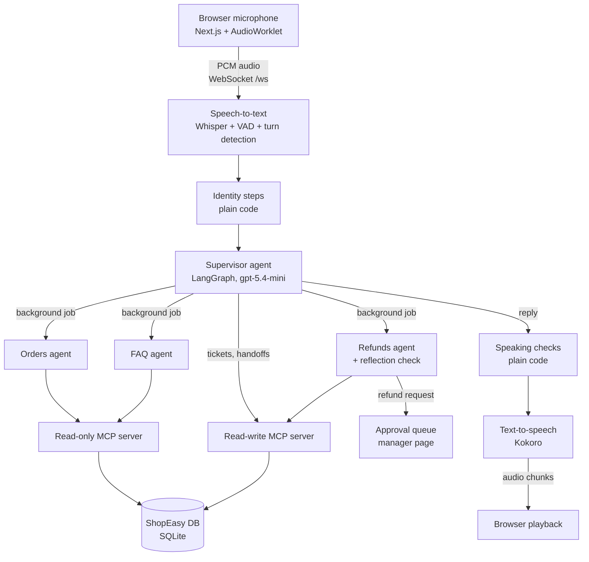

# ShopEasy Voice Support Agent

A real-time **voice** customer support agent for ShopEasy, a fictional online
shop. Customers speak to it in English from the browser, and it answers out
loud. It doesn't just talk: a team of LangGraph agents verifies the caller,
looks up orders, follows the shop's rules, opens tickets, and sends every
refund to a human for approval.


Final project of the *IA agentique* module (Master 2, AI Systems Engineering),
covering all five chapters of the course: foundations, reflection, tools, MCP
and multi-agent systems.

---

## Highlights

- **Real-time voice loop:** streaming speech-to-text, turn detection,
  interruption handling and streaming text-to-speech over one WebSocket, with
  a **0.83 s median time to the first spoken word**.
- **Supervisor + specialist team (LangGraph):** the supervisor is the only
  voice the customer hears. Orders, Refunds and FAQ agents work in the
  background with only their own tools, while the supervisor keeps the
  conversation going ("Let me check that for you").
- **Humans approve risky actions:** the agent never refunds on its own. A
  second model checks each refund against the real order and the return
  policy, then the request waits in an approval queue until a manager clicks
  Approve or Reject.
- **Layered guardrails:** identity checks in plain code, prompt-injection
  defence, checked messages between agents, least-privilege tools, and
  speaking checks before every answer.
- **Tools as MCP servers:** a read-only and a read-write server, both in Docker
  behind a token, using tools, resources and prompts. The same server also
  works from Claude Desktop.
- **Plans checked by code:** complex requests ("return the glasses and refund
  my card") become JSON plans that code validates before anything runs, with
  an "Are you sure?" before risky steps.
- **Measured, not guessed:** unit tests, 30+ conversation scenarios,
  AI-judge checks, an attack scenario for every guardrail, and an after-call
  grader for each call. Every step is traced to JSONL and LangSmith.

---

## Architecture



### How a call works

1. The browser streams microphone audio to the FastAPI backend over a WebSocket.
2. Whisper transcribes it, while voice activity and a turn-detection model
   decide when the customer has finished speaking.
3. **Identity steps run in plain code** before the model gets any tools: find
   the customer by phone number, then confirm "Am I speaking with Sara?". After
   three failed tries, the agent offers a human.
4. The **supervisor** answers directly or hands work to a specialist. Helper
   agents never talk to the customer: they return a structured answer
   (`done`, `needs_info` or `cannot`), and the supervisor speaks it as soon as
   nobody is talking.
5. Complex requests become a **JSON plan** that code validates step by step.
   Risky steps need the customer's confirmation, and refunds go to the
   **human approval queue** after a reflection check.
6. Every reply passes the **speaking checks** (no competitor names, not too
   long, no lists or symbols), then streams to text-to-speech, so speech starts
   before the full answer is ready. The customer can interrupt at any time.
7. After the call, a summary is written, reviewed by a second model and
   corrected, and the **after-call grader** scores the call with yes/no
   questions. The customer never waits for any of this.

---

## Guardrails

| Layer | What it does |
| --- | --- |
| Prompt-injection defence | "Ignore your rules" or "I'm an admin" changes nothing. |
| Agent layer | Each specialist checks the shop's rules for its own job. |
| Code layer | Plain code limits what each tool can read or change. |
| Message checks | What the supervisor sends to the helpers, and what comes back, is validated. |
| Least privilege | Each tool does only its own job, only for the verified customer, who is set by code and never by the model. |
| Human in the loop | Refunds and other risky requests go to a human, with a stronger identity check. |

Hard limits keep every call bounded: 5 tool calls per answer, 5 per helper
job, and 15 minutes per call with a spoken warning.

---

## MCP servers

The shop's tools are exposed through the Model Context Protocol, so they are
written once and used by any client.

| Server | Access | Used for |
| --- | --- | --- |
| Read-only | Orders, deliveries, FAQ, return policy | Orders and FAQ agents, analytics, Claude Desktop |
| Read-write | Tickets, handoffs, refund requests | Supervisor and Refunds agent |

- **All three MCP primitives:** tools (called by the agents), resources (the
  customer profile loaded at the start of a call) and prompts
  (`/summarize_call`).
- **Separated permissions:** an app that only needs to read can't change
  anything.
- **Docker + token** protect both servers.
- **One server, two apps:** the same read-only server answers "show me
  today's open tickets" for a manager in Claude Desktop.

---

## Design decisions

| Decision | Why |
| --- | --- |
| Identity in code, not in the prompt | It behaves the same way every time, and the model can't skip it. |
| Supervisor in front, specialists in the background | One voice for the customer, smaller prompts and fewer tools per agent, fewer mistakes. |
| Reflection only before refunds | Voice must stay fast; the second check runs only where a mistake is costly. |
| `gpt-5.4-mini`, reasoning `none` for the supervisor | The customer waits on the supervisor; background agents can afford a little reasoning. |
| Tools with limits | The model asks and code runs, so it can't loop forever or run up costs. |
| MCP for the tools | Write the tools once and use them from any app. |
| Tests read the call trace | They check what the agents really did, not just the final reply text. |

---

## Results

| Measure | Result |
| --- | --- |
| Core support scenarios (15 scenarios × 3 runs, real models) | **43/45 runs**, 14/15 scenarios passed every run |
| Median time to the first spoken word | **0.83 s** (0.82 s for order questions) |
| Cost of the 45 scenario runs | **≈ $0.20** |
| Unit tests (fake models, free) | **113 passed** in about 2 s |

### Scenario coverage

| Area | Examples |
| --- | --- |
| Identity | correct customer, wrong phone number, "that's not me" |
| Orders and deliveries | single order, several orders, late delivery, lost package |
| Returns and refunds | return allowed, too late to return, non-returnable item, refund approval |
| FAQ and policy | delivery cost, return policy |
| Handoff to a human | customer asks for a human, risky requests |
| Attacks | prompt injection, fake admin, another customer's order |

---

## Tech stack

| Layer | Technology |
| --- | --- |
| Frontend | Next.js 15, React 19: voice chat, live "agent brain" screen, manager page |
| Backend | FastAPI, WebSocket streaming |
| Speech | Whisper (faster-whisper) speech-to-text, transformer turn detection, Kokoro text-to-speech |
| Agents | LangGraph, LangChain, OpenAI `gpt-5.4-mini` (Responses API) |
| Tools | MCP servers (read-only + read-write) |
| Data | SQLite mock shop: customers, orders, deliveries, return policy, FAQ, tickets, handoffs |
| Observability | JSONL trace per call, LangSmith, LangGraph Studio |
| Testing | pytest, YAML conversation scenarios, AI-judge checks |
| Deployment | Docker / Docker Compose, Modal (serverless GPU) |

---

## Project structure

```text
.
├── backend/
│   ├── code/
│   │   ├── agents/      # supervisor, orders, refunds, faq, analytics
│   │   ├── shop/        # database, seed data, tools
│   │   ├── mcp/         # read-only and read-write MCP servers
│   │   ├── core/        # voice pipeline, session, traces
│   │   └── services/    # LLM client
│   └── tests/           # unit tests, scenarios, AI-judge
├── frontend/            # voice chat, agent brain screen, manager page
└── docs/                # goals, plans, diagrams, report
```

---

## Getting started

### Prerequisites

- An OpenAI API key
- Docker with an NVIDIA GPU, or a [Modal](https://modal.com) account for a
  serverless GPU
- Node.js 18.18+ and Python 3.10+
- Optional: a LangSmith API key for tracing

### Run it

```bash
cd backend
cp .env.example .env        # set OPENAI_API_KEY (and LANGSMITH_* if wanted)
docker compose -f docker-compose.openai.yml up -d --build
```

```bash
cd frontend
cp .env.example .env.local  # NEXT_PUBLIC_VOICE_SERVER_URL=http://localhost:8080
npm install
npm run dev
```

Open <http://localhost:3000>, press **Start** and allow the microphone.

**Try it** with the test customer Sara Benali, phone `07700900101` (one
order), or James Carter, `07700900102` (three orders). The other test
customers are in [`backend/code/shop/seed.py`](backend/code/shop/seed.py).

### Run on Modal instead

```bash
cd backend
.venv/bin/pip install modal
.venv/bin/modal token new                         # once
.venv/bin/modal deploy modal_app.py               # prints the https://…modal.run address
.venv/bin/modal app stop shopeasy-voice-agent     # when you are done
```

Enter the printed address as the server URL in the frontend. The container
scales to zero after 5 idle minutes.

### Run the tests

```bash
cd backend
python3 -m venv .venv
.venv/bin/pip install -r requirements-dev.txt
.venv/bin/pytest            # free unit tests
.venv/bin/pytest -m llm     # scenario tests with the real models (costs a few cents)
```

Scenarios are YAML files in [`backend/tests/scenarios/`](backend/tests/scenarios).
Each customer turn lists the tool and agent calls that must happen, calls that
must not happen, and facts the customer must hear; the checks read the call's
trace, so they test what really happened.

---

## Observability

- **Traces:** every call writes `backend/logs/traces/<session_id>.jsonl`, one
  JSON line per step (speech, identity steps, model calls with token counts,
  tool calls, helper jobs, limits, what was spoken), linked into a tree.
- **LangSmith** groups all runs of one call into a single thread.
- **LangGraph Studio** (`.venv/bin/langgraph dev` in `backend/`) lets you chat
  with any graph and watch it move from node to node.
- **Agent brain screen** shows each tool call, the plan and the timing live
  during a call.

---

## Acknowledgements

The real-time voice runtime started from
[RealtimeVoiceChat](https://github.com/KoljaB/RealtimeVoiceChat) and uses the
[RealtimeSTT](https://github.com/KoljaB/RealtimeSTT) and
[RealtimeTTS](https://github.com/KoljaB/RealtimeTTS) libraries, all by
[KoljaB](https://github.com/KoljaB). ShopEasy and all of its customers and
orders are made up.

Built by [badrafyf77](https://github.com/badrafyf77).
