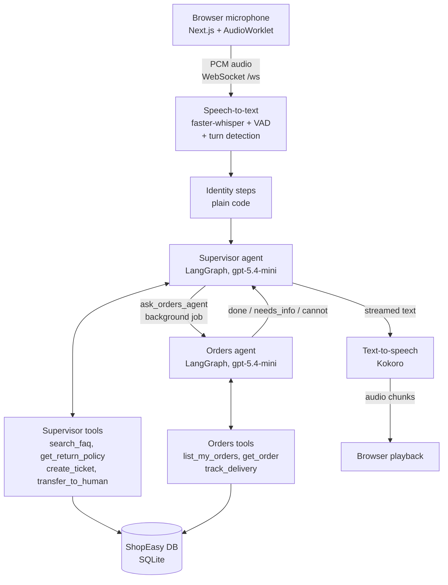

# ShopEasy Voice Support Agent

A real-time **voice** customer support agent for ShopEasy, a fictional online
shop. Customers speak to it in English from the browser, and it answers out
loud. Behind the voice, a LangGraph multi-agent system checks who the caller
is, looks up their orders and deliveries, answers policy questions, opens
tickets, and hands risky requests such as refunds to a human.


> **Status: in development.** Phase 1 (foundations) is complete and tested.
> Safety, MCP and a larger agent team are planned next; see the
> [roadmap](#roadmap). This is the final project of the *IA agentique* module
> (Master 2, AI Systems Engineering).

---

## Highlights

- **Real-time voice loop:** streaming speech-to-text, turn detection,
  interruption handling and streaming text-to-speech over one WebSocket.
  **0.83 s median time to the first spoken word.**
- **Supervisor + specialist agents (LangGraph):** the supervisor talks to the
  customer, while an orders agent works in the background and reports back.
  The supervisor keeps the conversation going ("Let me check that for you")
  until the answer is ready.
- **Critical steps in plain code:** identity verification (phone number, then
  name confirmation) runs before the model gets any tools. The verified
  customer is passed to every tool by code, never by the model.
- **Bounded by design:** 5 tool calls per answer, 5 per background job, and a
  15-minute call limit with a spoken warning.
- **Tested against real behaviour:** 113 unit tests on fake models, plus 15
  YAML conversation scenarios on the real models that check the exact tool and
  agent calls recorded in each call's trace (**43/45 runs passed**).
- **Observable:** one JSONL trace file per call, LangSmith tracing, and
  LangGraph Studio for stepping through the graphs.

---

## Architecture



**How a call works**

1. The browser streams microphone audio to the FastAPI backend over a WebSocket.
2. faster-whisper transcribes it, while voice activity and a turn-detection
   model decide when the customer has finished speaking.
3. The supervisor graph starts with the **identity steps in plain code**: find
   the customer by phone number, then confirm "Am I speaking with Sara?". After
   three failed tries, the agent offers a human.
4. Once the customer is verified, the supervisor model answers using its own
   tools, or delegates order questions with `ask_orders_agent`.
5. The **orders agent** runs in a background thread with its own tools and
   returns a structured answer: `done`, `needs_info` or `cannot`. The
   supervisor speaks the result as soon as nobody is talking.
6. The supervisor's reply is streamed to text-to-speech as it is generated, so
   speech starts before the full answer is ready, and is played back in the
   browser. The customer can interrupt at any time.

A file-by-file map of the backend is in
[`backend/code/ARCHITECTURE.md`](backend/code/ARCHITECTURE.md).

---

## Design decisions

| Decision | Why |
| --- | --- |
| Identity checks in code, not in the prompt | They must behave the same way every time, and the model cannot skip them. |
| Verified customer injected by code into every tool | The model can't read or change another customer's data, even if asked to. |
| Supervisor in front, specialists in the background | One voice for the customer, smaller prompts and fewer tools per agent. |
| Structured answers from the orders agent | `done` / `needs_info` / `cannot` makes the hand-back predictable and testable. |
| `gpt-5.4-mini` with reasoning `none` for the supervisor, `low` for the orders agent | The customer waits on the supervisor, so it needs to be fast; the background agent can afford a little reasoning to follow the shop's rules. |
| Hard limits on tool calls and call length | The agent can't loop forever or run up costs. |
| Refunds always go to a human | The agent never takes an action that can't be undone on its own. |
| Tests read the trace, not the reply text | They check what the agents really did (which tools, which agents, what was spoken). |

---

## Results

Measured in November 2026 on Phase 1, with both agents on `gpt-5.4-mini`.

| Measure | Result |
| --- | --- |
| Unit tests (fake models, free) | **113 passed** |
| Conversation scenarios (15 scenarios × 3 runs, real models) | **43/45 runs**, 14/15 scenarios passed every run |
| Median time to the first spoken word | **0.83 s** (0.82 s for order questions) |
| Cost of the 45 scenario runs | **≈ $0.20** |

Both failed runs were in `return_too_late`. After the fix to the orders
prompt, that scenario passed 3/3. The full 45-run score hasn't been repeated
since that fix.

### Scenario coverage

| Area | Scenarios |
| --- | --- |
| Identity | correct customer, wrong phone number, "that's not me" |
| Orders and deliveries | single order, several orders (needs more info), late delivery, lost package |
| Returns | return allowed, too late to return, non-returnable item |
| FAQ and policy | delivery cost, general return policy |
| Handoff to a human | customer asks for a human, refund request |
| Security | asking about another customer's order |

---

## Tech stack

| Layer | Technology |
| --- | --- |
| Frontend | Next.js 15, React 19, AudioWorklet capture and playback |
| Backend | FastAPI, WebSocket streaming |
| Speech | faster-whisper (`medium.en` final, `small.en` real-time) via RealtimeSTT, transformer turn detection, Kokoro TTS via RealtimeTTS |
| Agents | LangGraph, LangChain, OpenAI `gpt-5.4-mini` (Responses API) |
| Data | SQLite mock shop: 10 customers, 25 orders, deliveries, return policy, FAQ, tickets, handoffs |
| Observability | JSONL trace per call, LangSmith, LangGraph Studio |
| Testing | pytest, YAML conversation scenarios, scripted fake chat models |
| Deployment | Modal (serverless GPU), Docker / Docker Compose |

---

## Project structure

```text
.
├── backend/
│   ├── code/
│   │   ├── server.py            # FastAPI app: GET / health, WS /ws voice sessions
│   │   ├── agents/
│   │   │   ├── support/         # supervisor graph: identity -> model <-> tools
│   │   │   ├── orders/          # orders specialist graph (background)
│   │   │   ├── graph.py         # shared model <-> tools nodes, tool-call limit
│   │   │   └── models.py        # ChatOpenAI built from each agent's config.yaml
│   │   ├── shop/                # mock ShopEasy database, seed data and tools
│   │   ├── core/                # voice runtime: session, STT/TTS nodes, pipeline, traces
│   │   └── services/            # LLM client used by the speech pipeline
│   ├── tests/                   # unit tests, YAML scenarios, text runner, spoken test call
│   ├── modal_app.py             # Modal deployment (GPU in the cloud)
│   └── docker-compose*.yml      # Docker stacks (OpenAI or local vLLM)
├── frontend/                    # one-page voice chat (Next.js)
└── docs/
    ├── goals/                   # project goals and roadmap, one file per course chapter
    └── plans/                   # Phase 1 plan and status
```

---

## Getting started

### Prerequisites

- An OpenAI API key (the agents use `gpt-5.4-mini`)
- Python 3.10+ (3.11+ for LangGraph Studio) and Node.js 18.18+
- For the voice backend: a GPU, either through [Modal](https://modal.com)
  (tested) or a local NVIDIA machine with Docker
- Optional: a LangSmith API key for tracing

### 1. Run the tests (no GPU, no API cost)

```bash
cd backend
python3 -m venv .venv
.venv/bin/pip install -r requirements-dev.txt
.venv/bin/pytest                                   # 113 unit tests, about 2 s
```

With an OpenAI key in `backend/.env`, you can also run the real-model
scenarios (about $0.20 for the full set):

```bash
SCENARIO_RUNS=1 .venv/bin/pytest -m llm -k track_single_order   # one scenario, once
.venv/bin/pytest -m llm                                          # all 15 scenarios x 3 runs
```

### 2. Start the voice backend

```bash
cd backend
cp .env.example .env              # set OPENAI_API_KEY (and LANGSMITH_* if wanted)
```

**On Modal (serverless GPU):**

```bash
.venv/bin/pip install modal
.venv/bin/modal token new                         # once
.venv/bin/modal deploy modal_app.py               # prints the https://…modal.run address
.venv/bin/modal app stop shopeasy-voice-agent     # when you are done
```

The container scales to zero after 5 idle minutes. A cold start can take a few
minutes, so open the health endpoint first and wait for `"status":"ok"`.

**With Docker on a local NVIDIA GPU:**

```bash
docker compose -f docker-compose.openai.yml up -d --build
curl http://localhost:8080/
```

### 3. Start the frontend

```bash
cd frontend
cp .env.example .env.local        # NEXT_PUBLIC_VOICE_SERVER_URL=http://localhost:8080
npm install
npm run dev
```

Open <http://localhost:3000>, enter the backend address if it differs, press
**Start** and allow the microphone (Chrome or Safari).

**Try it** with the test customer Sara Benali, phone `07700900101` (one
order), or James Carter, `07700900102` (three orders). The other test
customers are in [`backend/code/shop/seed.py`](backend/code/shop/seed.py).

---

## Testing and observability

- **Unit tests** use scripted fake chat models, so they are free, fast and
  deterministic.
- **Scenario tests** are YAML files in
  [`backend/tests/scenarios/`](backend/tests/scenarios). Each customer turn
  lists the tool and agent calls that must happen, calls that must not happen,
  the orders agent's expected answer, and facts the customer must hear. A
  text-only runner plays the conversation without audio, then the checks read
  the call's trace.
- **Traces:** every call writes `backend/logs/traces/<session_id>.jsonl`, one
  JSON line per step (speech, identity steps, model calls with token counts,
  tool calls, background jobs, limits, what was spoken), linked into a tree by
  `parent_id`.
- **LangSmith** groups all runs of one call into a single thread. **LangGraph
  Studio** (`.venv/bin/langgraph dev` in `backend/`) lets you chat with either
  graph and watch it move from node to node.
- **Spoken test call:** `tests/voice_call.py` plays synthetic speech into the
  WebSocket like a microphone and reports what the agent heard, said, and how
  fast it answered (macOS).

More detail: [`backend/README.md`](backend/README.md).

---

## Roadmap

The full plan, with one document per course chapter, is in
[`docs/goals/`](docs/goals/README.md).

- [x] **Phase 0: Clean base.** Removed the earlier exam agent and Darija code to start from an English-only voice runtime.
- [x] **Phase 1: Foundations.** Mock shop database, tool calling with limits, identity steps in code, supervisor + background orders agent on LangGraph, traces, 15 scenarios, Modal deployment.
- [ ] **Phase 2: Safety and quality.** Human approval queue for refunds, reflection before refunds, speaking checks, prompt-injection defence and layered guardrails, 30+ scenarios with AI-judge checks and attack tests.
- [ ] **Phase 3: MCP.** Move the shop tools to MCP servers (tools, resources and prompts), split into read-only and read-write servers protected by a token, running in Docker.
- [ ] **Phase 4: Agent team and plans.** Refunds and FAQ agents, JSON plans checked by code before they run, confirmation before risky steps, an analytics agent and an after-call grader.
- [ ] **Phase 5: Screens and report.** Live "agent brain" view during a call, manager page for approvals and call summaries, final report with test results.

### Known limitations

- A full spoken conversation past the identity step hasn't been verified end to
  end yet; the agent logic is covered by the text scenarios.
- A phone number spoken with a long pause is split into two turns and fails
  the first identity attempt.
- After a failed identity check or a transfer, the agent stops answering, but
  the call stays open until the customer hangs up.
- Docker Compose hasn't been re-tested since Modal became the main way to run
  the voice backend.

---

## Acknowledgements

The real-time voice runtime started from
[RealtimeVoiceChat](https://github.com/KoljaB/RealtimeVoiceChat) and uses the
[RealtimeSTT](https://github.com/KoljaB/RealtimeSTT) and
[RealtimeTTS](https://github.com/KoljaB/RealtimeTTS) libraries, all by
[KoljaB](https://github.com/KoljaB). ShopEasy and all of its customers and
orders are made up.

Built by [badrafyf77](https://github.com/badrafyf77).
