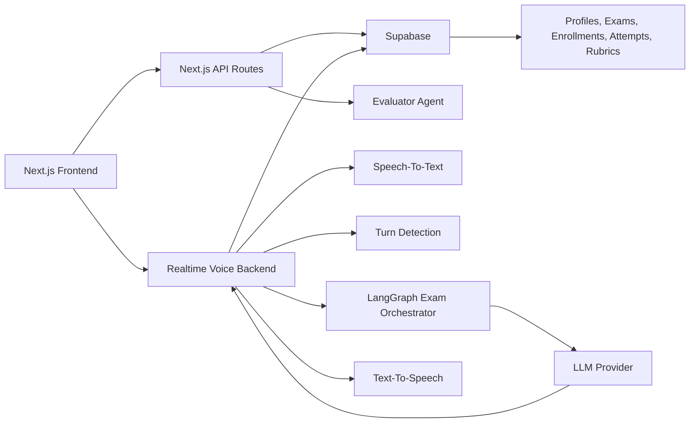

# Veridex

Veridex is an AI-powered examination platform for teacher-created assessments. It combines a Next.js web application, a Supabase-backed exam domain, and a realtime voice backend so teachers can run oral, written, or hybrid exams with private per-student attempts, transcripts, and evaluation results.

## Overview

The project is built around one core idea: make assessments structured, trackable, and AI-assisted without turning them into generic chat sessions.

With Veridex, you can:

- create oral, written, and hybrid exams
- define difficulty, duration, question count, and rubric criteria
- publish exams and let students join with a join code
- run AI-led oral exams where Veridex asks questions in realtime
- store transcripts, written answers, and attempt history in Supabase
- evaluate attempts against rubric criteria and save structured feedback

## What The Product Does

### For teachers

- create exams with title, subject, instructions, timing, and rubric
- choose exam mode: `oral`, `written`, or `hybrid`
- control question count, retakes, and evaluation behavior
- review attempts, transcripts, scores, and evaluator summaries

### For students

- join published exams using a join code
- start and resume attempts
- take live oral exams in a webcam + microphone workspace
- receive stored evaluation results after submission or automatic oral-exam completion

## Architecture



### Main system parts

- `frontend/`: the main web product built with Next.js 15, React 19, Tailwind, and Supabase
- `backend/ExaminerAgent/`: the realtime oral-exam engine built with FastAPI, streaming STT/LLM/TTS, and LangGraph-based exam control
- `backend/EvaluatorAgent/`: evaluator trigger service scaffold (FastAPI + LangGraph-ready workflow)
- `frontend/supabase/`: schema, migrations, and seed configuration for the exam domain

## Repository Structure

```text
.
├── backend/
│   ├── ExaminerAgent/         # realtime oral exam backend
│   └── EvaluatorAgent/        # evaluator LangGraph backend scaffold
├── frontend/                  # Next.js app, API routes, UI, exam workflows
├── REALTIME_EXAM_HANDOFF.md   # project handoff/context notes
└── README.md                  # this file
```

## How Oral Exams Work

1. A teacher creates an oral or hybrid exam in the frontend.
2. Exam metadata and rubric criteria are stored in Supabase.
3. A student joins the exam and starts an attempt.
4. The oral exam room connects to the realtime backend over WebSocket.
5. The backend loads the student profile, exam details, rubric, and attempt context.
6. Veridex leads the oral exam, asks the configured number of questions, and keeps the session structured.
7. Audio is transcribed, the next oral-exam turn is generated, and speech is streamed back to the student.
8. When the target question count is reached, Veridex closes the exam automatically.
9. The attempt transcript is saved in Supabase and submitted by the examiner service.
10. The frontend triggers evaluator-agent to process the submitted attempt.

## Domain Model

The project currently revolves around these main records:

- `profiles`: teacher, student, and admin profiles
- `exams`: the exam definition created by a teacher
- `exam_rubric_criteria`: scoring criteria and weights
- `exam_enrollments`: which students joined which exams
- `exam_attempts`: private attempt records, transcripts, answers, scores, and feedback

## What You Can Extend

This repository already gives you a strong base for:

- AI oral examination workflows
- rubric-based evaluation
- teacher dashboards and student attempt history
- exam lifecycle management
- hybrid assessments that combine oral and written components

Natural next steps include:

- stronger teacher analytics
- richer manual review workflows
- notification flows
- classroom or cohort management
- better evaluator customization
- production deployment automation

## Quick Start

### 1. Frontend

```bash
cd frontend
npm install
cp .env.local.example .env.local
npm run dev
```

The frontend runs on `http://162.243.59.37:3000` by default.

### 2. Examiner-agent + evaluator-agent backend

Recommended default:

```bash
cd backend/ExaminerAgent
cp .env.example .env
docker compose up -d --build
```

With the default `docker-compose.yml`:

- app health endpoint: `http://162.243.59.37:8080/`
- WebSocket base URL for the frontend: `ws://162.243.59.37:8080`
- evaluator-agent endpoint: `http://162.243.59.37:8090`

The backend stack now focuses on `vllm` and `openai` provider modes through the same compose setup.

### 3. Connect frontend to backend

Set `NEXT_PUBLIC_EXAM_SERVER_URL` in `frontend/.env.local`.
Set `EVALUATOR_AGENT_BASE_URL` in `frontend/.env.local`.
Set `EXAM_GENERATOR_URL` in `frontend/.env.local`.

Use this value for the backend stack:

- `ws://162.243.59.37:8080` for the vLLM/OpenAI Docker stack
- `http://162.243.59.37:8090` for evaluator trigger requests
- `http://162.243.59.37:8001` for exam generator upload/generate routes

## Environment Notes

### Frontend

Important variables:

- `NEXT_PUBLIC_SUPABASE_URL`
- `NEXT_PUBLIC_SUPABASE_ANON_KEY`
- `SUPABASE_SERVICE_ROLE_KEY`
- `NEXT_PUBLIC_SITE_URL`
- `NEXT_PUBLIC_EXAM_SERVER_URL`
- `EVALUATOR_AGENT_BASE_URL`
- `EXAM_GENERATOR_URL`

Optional if billing pages are still in use:

- `NEXT_PUBLIC_PADDLE_ENV`
- `PADDLE_API_KEY`
- `PADDLE_NOTIFICATION_WEBHOOK_SECRET`
- `NEXT_PUBLIC_PADDLE_CLIENT_TOKEN`

### Backend

Important variables:

- `LLM_PROVIDER`
- `LLM_MODEL`
- `SUPABASE_URL`
- `SUPABASE_SERVICE_ROLE_KEY`
- `OPENAI_API_KEY`
- provider-specific variable `VLLM_BASE_URL` (for vLLM mode)

## Tech Stack

### Frontend

- Next.js 15
- React 19
- TypeScript
- Tailwind CSS
- Supabase

### Backend

- FastAPI
- Whisper-based realtime transcription
- LangGraph for oral-exam flow control
- pluggable LLM providers: vLLM and OpenAI
- Kokoro / RealtimeTTS-based speech output

## Documentation In This Repo

- [frontend/README.md](./frontend/README.md)
- [backend/ExaminerAgent/README.md](./backend/ExaminerAgent/README.md)
- [REALTIME_EXAM_HANDOFF.md](./REALTIME_EXAM_HANDOFF.md)

## Current Scope

The repo still contains some onboarding, dashboard, and billing/subscription code, but the main product direction is clearly the exam platform:

- exam authoring
- student enrollment and attempts
- AI-led oral examinations
- stored evaluation results

## License

No license has been declared yet.
